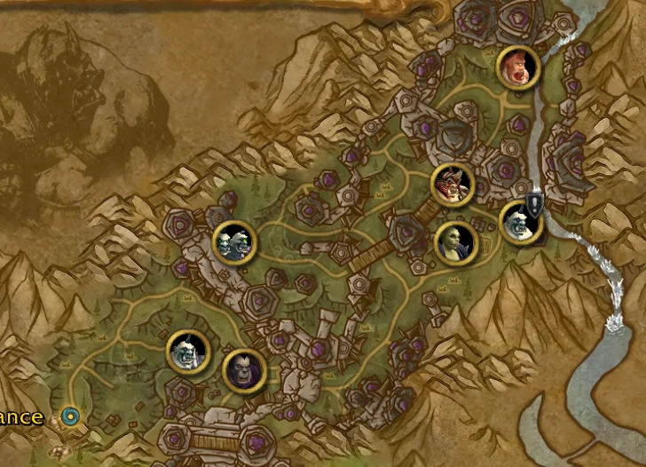
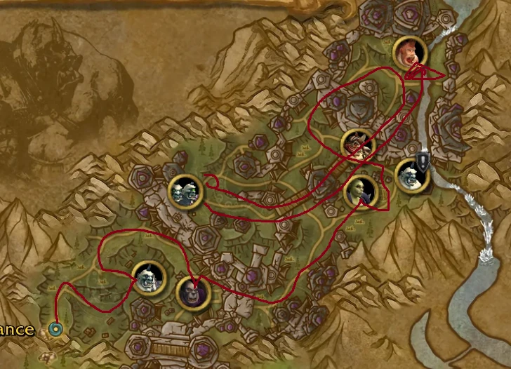

# Krol'dok Stronghold: farm model (2026-11-23)

Theorycraft for a solo Protection Warrior at level 47. Drop rates come from Wowhead "Drops" tabs
(screenshots supplied by hand, 1,453–2,069 kills sampled per boss). Every boss blue is
bind-on-pickup, so it's vendor income.

## Vendor prices
All sell prices and drop rates come from Wowhead tooltips (screen recordings supplied by the
user, 2026-11-23). No estimates are left in the boss table.

## Expected value per boss kill
| Boss | Drops: sell price (drop %) | EV per kill |
|---|---|---|
| **Slavecrusher Grox** | Slavecrusher Scepter 1g 72s 54c (35.17%), Resistance Breaker Spaulder 78s 29c (31.04%), Chain of Binding 52s 16c (33.04%), **Blueprint: Expert Campfire ~27g on the AH (4.54%)** | **2g 19s** (1g 16s of it from the blueprint) |
| **Overlord Mugg** | Mugg's Jabber 2g 33s 36c (24.99%), Mugg's Crosser 2g 34s 20c (21.89%), Emblem of Slamming 94s 01c (20.98%), Strongly Scented Hood 70s 75c (24.31%); Eye of Mugg (quest item) 44%; **Krol'dok Ogre Key 14%** | **1g 47s** |
| War Handler Ashka | Bloodied Gutslicer 2g 38s 30c (36.44%), Worgbinder's Treads 1g 00s 64c (29.20%), War Handler's Gaze 71s 94c (34.37%) | 1g 41s |
| Bossman Toof | Toofbreaker 2g 03s 18c (36.21%), Band of Bossman 80s 70c (31.58%), Big-Belly Belt 40s 49c (32.21%) | 1g 12s |
| Twilight Commander Zarmok | Shadowlight Athame 1g 88s 48c (32.38%), Zarmok's Plated Signet 75s 97c (34.30%), Shadecaster's Leggings 75s 68c (31.69%) | 1g 11s |
| Nar'gurk | Krol'dok Warplate Chest 1g 50s 18c (26.14%), Krol'dok Warplate Helmet 1g 12s 81c (28.10%), Chain of the Corruptor 83s 28c (35.84%); Tome of Twilight (quest item) 42% | 1g 01s |
| Kroog (rare) | Black Horn Necklace, Kroog's Backscratcher | not counted: spawn rate unknown |
| **All 6 bosses** | | **~8g 31s per run** |

Zone-wide quest drops: Cultist Ear 4%, Twilight Bangle 2%. Very rare: Sturdy Junkbox and
Aquamarine (0.06% each).

## Per hour
- Bosses only: 5 runs × ~8.3g ≈ **~41.5 g/hr** (the blueprint is ~5.8 g/hr of that, and comes in
  ~25g lumps about every 4.4 hours).
- Plus elite trash coin and greys: **not yet measured.**
- Over half the expected value comes from 6 weapons worth 1g 72s–2g 38s each (Scepter,
  Gutslicer, Athame, Toofbreaker, Jabber, Crosser), so single hours will vary widely.

## Krol'dok Battlegear set: farming value
The full 5-piece set: Helmet and Chest from Nar'gurk; Pauldrons, Legplates and Gauntlets from
trash (not yet confirmed).
- (2) +100 armor
- (3) +5 Defense
- (4) Chance on block to heal for 14–23. **Healing is doubled in Strongholds and Cities**, and
  Krol'dok is a Stronghold.
- (5) Taking damage has a high chance to add 1 Stamina for 30 seconds, stacking up to 20 times.

The 4-piece healing is doubled in Krol'dok itself, so the set directly supports bigger pulls
there. Equip pieces as they drop rather than vendoring them.

## Map and route

The entrance is at the bottom left. Confirmed portraits:
- **Slavecrusher Grox:** the first ogre, next to the entrance.
- **Twilight Commander Zarmok:** the hooded figure beside Grox.
- **Nar'gurk:** the ogre in the west-middle.
- **War Handler Ashka:** the green-skinned figure, east-middle.
- **Bossman Toof:** the red-horned ogre, just north of Ashka.
- **Overlord Mugg:** the bald ogre at the top (northeast).
- **The ogre with a "!" marker by the river:** Tunk the Blacksmith (written "Thunk" earlier).
  Skippable: his Moulding leads to the Krol'dok Ogre Key, which the player already has. The rare Kroog isn't on this map; note where he spawns
  if you see him.

The leveling route (red line): entrance → loop north → Grox → Zarmok → east along the south →
Ashka → **west to Nar'gurk and back** → Toof → loop → Mugg.

What can be improved:
1. **The Krol'dok Ogre Key opens a shortcut to Toof** (the player has the key). With it, the
   route reaches Toof directly and then backtracks to Nar'gurk. Exact order and timing to be
   confirmed on the timed run.
2. **The opening loop north** before Grox may be trash you can skip. It may also have been
   for quests while leveling.
3. **There's no shortcut out after Mugg: you run back from the top northeast to the entrance
   at the bottom left** (mounted). That return trip is fixed time with no loot, so it counts
   against Mugg's part of the route. Time it: if the full route goes over 12 minutes, the
   decision is whether Ashka + Toof + Mugg (4g 00s together) are worth the trip east plus the
   run back.
4. **Once you have the Warplate Helmet and Chest,** Nar'gurk is the lowest-value boss
   (1g 01s) and the longest detour, so he's the first to skip if a run runs long.

Value along the proposed route: Grox 2g 19s → Zarmok 1g 11s → Nar'gurk 1g 01s → Ashka 1g 41s
→ Toof 1g 12s → Mugg 1g 47s. The bosses nearest the entrance (Grox and Zarmok) are 3g 30s,
or 40% of the run's boss value.

## Notes from a dungeon guide video (2026-11-23)
Source: an edited 2½-minute **group** guide (supplied via Google Drive). It's not a solo run
and it's cut, so it gives **no timings**. Map overlay credited to Santiago Reyes.

**Boss order shown:** Grox → Zarmok → the cultist area → Ashka → Tunk → Nar'gurk (Zalfan
Moonshadow is also in the cultist area) → the bridge (Toof: "Hold da bridge!") → Mugg.

**Tunk the Blacksmith matters for the tank set:**
- He drops the **Krol'dok Moulding** (51.48%, BoP, starts a quest): "The moulding appears to
  be for a key." The quest is to find someone in Farholde Keep who knows about the mould.
  Reward: 55s and 3,399 XP.
- The Moulding chain gives the **Krol'dok Ogre Key**, which the player already has, so
  **Tunk is skippable.** The video listed the Moulding near the Battlegear set, but where the
  Pauldrons, Legplates and Gauntlets come from is still unconfirmed.

**Mechanics that matter solo:**
| Where | Threat | Why it matters for a prot warrior |
|---|---|---|
| Grox | Force Compliance (pulls nearby Redridge Prisoners into the fight), Bloodlust, Knockdown | Pull him clear of the prisoners, or expect adds |
| Zarmok | Charge, Enrage, Rending Whirl (AoE bleed) | Manageable |
| Cultist area | **Twilight Peons run to alert other mobs**; Warlocks (Immolate, Rain of Fire); Shadowhide Curseweaver (Shadow Bolt, Curse of Tongues); Shadowhide Bully (Knockdown) | Casters give no rage from blocking. Kill or stun Peons first, or the pack grows. |
| Ashka | Two wolves: **Terrorhowl, 60-yard AoE fear**; Snarlfang (Rend); "Command: Kill" | A fear while holding a pack is the biggest solo risk; plan a fear break (Berserker Rage, or Will of the Forsaken if Undead) |
| Nar'gurk | Shadowbolt Volley, **Convert (mind control)** | Effect on a solo player is unknown; watch it in the test run |
| Bridge trash | Krol'dok Centurions (**Mortal Strike**, Thunderclap, Demoralizing Roar), Shamans, Brutes | Mortal Strike cuts healing, including the Battlegear heal on block |
| Mugg | Crushing Slam (jumps 3 times), Set of Maces / Set of Mauls (+20% / +50% melee), Mugg's Fury (stacking attack speed, resets when he swaps weapons) | Biggest burst; save cooldowns for the Mauls phase |

**Trash loot seen** (Horde AH prices, 2026-11-23):
| Item | Source | Vendor | AH | Verdict |
|---|---|---|---|---|
| Coin | every mob | — | — | group shares of 16c–1s 34c, so roughly **1–7s per mob solo** |
| Thick Leather | Ashka's wolves | 3s | 6–8s | AH |
| Heavy Leather | Ashka's wolves | 1s 50c | 2–3s | AH |
| Red Wolf Meat | Ashka's wolves | 87c | ~2s 60c–3s | AH |
| Thick Furry Mane (grey) | Ashka's wolves | 8s 12c | ~8s | vendor |
| Mageweave Cloth | Shadowhide Bully | 3s | 4s | either |
| Overlinked Chain Belt / Shoulderpads (grey) | trash | 18–24s | 37–65s, ~6 listed | vendor (thin market) |

**One-time Horde quests** (all already completed by the player; quest drops have no farm value):
- Eye of Mugg: Krom'rosh, Riverglades (59.4, 45.6)
- Tome of Twilight: Tran'gul, Riverglades (59.6, 44.0)
- A Token of Vengeance: Da'grosh, Riverglades (33.4, 38.0)
- Prerequisite chain: "A Message in Blood" and "Food for the Taking", from Krom'rosh

## Route rules
1. **The cap sets the target.** 5 instances an hour means a run can take up to 12 minutes,
   leaving ~10 minutes of killing after ~2 for exit and reset. Finishing faster than that
   earns nothing extra in the dungeon. Use leftover minutes for fishing instead.
2. **Kill all 6 bosses if the route fits in about 12 minutes.** Every boss is worth 1g 01s–2g 19s
   per kill, so none is an obvious skip.
3. **If a full route runs over 12 minutes, cut the low-value parts.** Drop the lowest gold per
   minute first. With every boss at 1–2.2g, the decision comes down to the minutes each
   one costs. Measure those in a timed run. Never cut Grox.
4. **Trash:** clear what's in the way. Take extra melee packs only if they fit in the 12
   minutes. Avoid caster packs (Twilight cultists), because you get no rage from blocking.
   Measured coin per pull will decide whether optional packs are worth it.
5. The average run earns ~0.85g per minute. Any optional section that pays less than that per
   minute, and pushes the run over 12 minutes, should be cut.

## Still needed
1. **A timed test run:** the time at each boss kill, the time to exit and reset, gold before
   and after (greys vendored, blues kept), and the repair bill. Log it in `docs/farm-log.md`.
2. **Trash:** which packs block the paths between bosses and which you can skip.
3. **Kroog:** how often he spawns, and his sell prices.
4. **Professions:** Skinning, for Ashka's wolves. Thick Leather sells for 6–8s on the AH.
